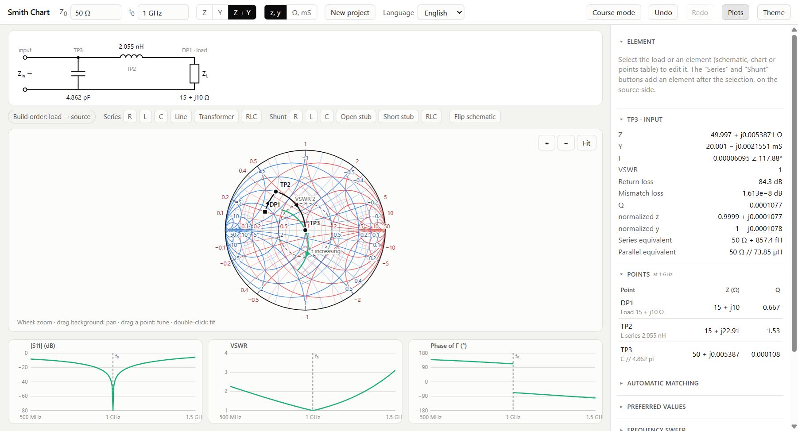
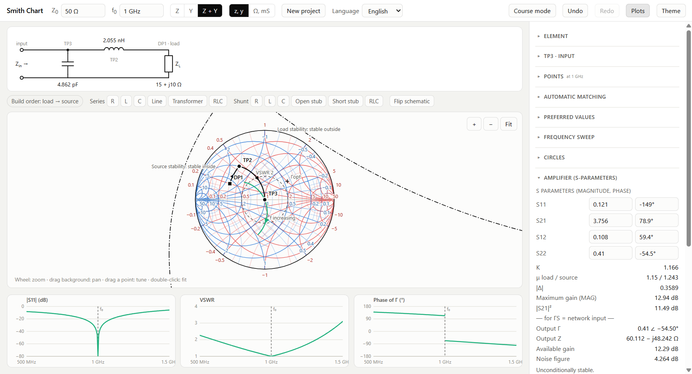

# Interactive Smith chart

[](https://github.com/blatti-thomas/smith-chart/releases/latest)
[](LICENSE)

Smith chart and impedance-matching tool built for the SysRF course (HEIG-VD, chapter 8), designed to
replace Smith V3.10 by F. Dellsperger. One file, no installation, no network connection.
The interface is available in English, French, German, Italian and Spanish.

## Screenshots

An L-section network (series 2.055 nH, shunt 4.862 pF) matching a 15 + j10 Ω load to 50 Ω at 1 GHz: schematic,
Smith chart with the element trajectories, VSWR circle, readout panel and frequency sweep plots.
Light and dark themes follow the system setting.

<p align="center">
  <picture>
    <source media="(prefers-color-scheme: dark)" srcset="docs/screenshots/main-dark.png">
    
  </picture>
</p>

Amplifier panel (S parameters, stability circles, gain and noise figure), with the BFG33G example:

<p align="center">
  <picture>
    <source media="(prefers-color-scheme: dark)" srcset="docs/screenshots/amplifier-dark.png">
    
  </picture>
</p>

## Download

Desktop builds are attached to every [release](https://github.com/blatti-thomas/smith-chart/releases/latest).
The links below always point to the latest version.

| Platform | Download |
|---|---|
| Windows (installer) | [Smith-Chart-Windows-Setup-x64.exe](https://github.com/blatti-thomas/smith-chart/releases/latest/download/Smith-Chart-Windows-Setup-x64.exe) |
| Windows (portable, no installation) | [Smith-Chart-Windows-Portable-x64.exe](https://github.com/blatti-thomas/smith-chart/releases/latest/download/Smith-Chart-Windows-Portable-x64.exe) |
| macOS, Apple Silicon (M1 and later) | [Smith-Chart-macOS-arm64.dmg](https://github.com/blatti-thomas/smith-chart/releases/latest/download/Smith-Chart-macOS-arm64.dmg) |
| macOS, Intel | [Smith-Chart-macOS-x64.dmg](https://github.com/blatti-thomas/smith-chart/releases/latest/download/Smith-Chart-macOS-x64.dmg) |

The builds are not code-signed. Windows SmartScreen may warn on first launch ("More info" → "Run anyway").
On macOS, open the app with right-click → Open the first time (or run
`xattr -dr com.apple.quarantine "/Applications/Smith Chart.app"`).

You can also skip the installer: download the repository and open `index.html` in a browser.

## Files

| File | Role |
|---|---|
| `index.html` | The complete tool: open this file in a browser |
| `tests.mjs` | Tests of the calculation engine: `node tests.mjs` (Node ≥ 18, no dependency) |
| `i18n-check.mjs` | Checks that every UI string is translated in every language: `node i18n-check.mjs` |
| `SPEC.md` | Specification: functions taken from Smith, added, excluded, and why |
| `docs/screenshots/` | Images shown in this README |
| `main.js`, `package.json` | Desktop wrapper (Electron) used to build the Windows and macOS apps |

## Usage

Open `index.html`: an empty project with a 50 Ω load. "New project" resets it. The "Language" menu switches the interface language (the browser language
is used by default, and the choice is remembered).

**Build a network.** The network is built **from the load towards the source**: the first element touches
the load, and the input impedance is seen after the last element.

1. Set `Z0` and `f0` in the top bar.
2. Click the load in the schematic and enter it (Z, Y, normalized values, Γ, S11, R-L-C circuit or Z(f)
   table). The DP1 point can also be dragged on the chart.
3. Add elements with the "Series" and "Shunt" buttons. The new element is inserted after the selected
   element, on the source side, and its value field gets the focus: type the value, then Enter.

**Enter a value.** Free engineering notation: `6.8p`, `6,8 pF`, `15n`, `869M`, `2k2`, `4R7`, `1e-9`.
Prefixes and units are case-sensitive (`m` = milli, `M` = mega); an ambiguous entry such as `869mhz` is
rejected.

**Tune a value.**

| Gesture | Effect |
|---|---|
| Mouse wheel or ↑ ↓ arrows on a field | ± 1 % (± 1° for an angle); Shift: × 10; Alt: ÷ 10 |
| "Tuning" slider | Sweeps around the value; returns to the centre when released |
| Drag a TP point on the chart | Tunes the element that ends at this point, along its locus |
| Drag DP1 | Moves a fixed load |

**Read the chart.** The readout panel gives Z, Y, Γ, VSWR, return loss, mismatch loss, Q, the normalized
values and the equivalent components, for the cursor, a hovered point, a sweep sample or, by default,
the network input. Wheel: zoom; drag the background: pan; double-click or `0`: fit.

**Inspector panels** (collapsible): automatic matching, preferred values E12/E24/E96, frequency sweep,
VSWR and Q circles, amplifier (stability, gain, noise), files and exports.

**Keyboard.** `Ctrl+Z` / `Ctrl+Y` undo and redo; `Ctrl+S` save the project; `Ctrl+O` open;
`Del` delete the selected element; `Esc` deselect; ← → arrows in the schematic;
`+` `−` `0` and arrows on the chart.

**Share.** The project is encoded in the page address: "Copy link" is enough. "Save" produces a JSON
file.

## RF conventions

- ω = 2πf; Z_L = jωL; Z_C = 1/(jωC); Γ = (Z − Z0)/(Z + Z0), Z0 real.
- VSWR = (1 + |Γ|)/(1 − |Γ|); return loss = −20·log|Γ| (positive); mismatch loss = −10·log(1 − |Γ|²).
- Q of a point = |X|/R.
- Series element: motion along an r circle. Shunt element: motion along a g circle.
- **Lines.** The electrical length is defined at a reference frequency; the line keeps its physical
  length when the frequency varies. Physical length = electrical length / √εr_eff. Loss α in dB per
  metre of physical length, α·√(f/f_ref) by default (conductor) or constant.
- Open stub: Y = tanh(γl)/Zc. Short-circuited stub: Y = coth(γl)/Zc.
- **Ideal transformer** of ratio n: Zin = n²·Z, n = turns on the source side / turns on the load side.
- **Finite Q**: series resistance constant in frequency, given directly or derived from a Q at one
  frequency.
- **Load during a sweep**: a fixed impedance stays fixed (as in Smith); an R-L-C circuit varies; a table
  is interpolated linearly on Γ, without extrapolation.
- **π and T at imposed Q**: Q is the highest node Q inside the network (virtual resistance
  Rhigh/(Q² + 1) for the π, Rlow·(Q² + 1) for the T).
- **Bandwidth of a solution**: range around f0 where the return loss with respect to the target stays
  above the threshold, measured on the real network with the project's load model.
- **Amplifier**: the source seen by the transistor is the network input. Start from 50 Ω as the "load"
  and build towards the transistor (method 2 of Dellsperger's example 14).

## Verification

`node tests.mjs` extracts the `smith-core` and `smith-chart` blocks of `index.html` and runs them as
they are: the tested code is the shipped code. Over 100 tests cover:

- the 8 course vectors, the slide 17 chain (values displayed by Smith V3.10) and Dellsperger's examples
  1, 4, 9, 10, 11 and 13;
- every formula through an independent path: series/parallel reduction, closed tanh equation, ABCD
  matrices, nodal solver for the LTspice netlist, gain and noise formulas evaluated on the circles;
- every synthesized network, fed back into the forward engine;
- edge cases (short circuit, open circuit, f = 0, |Γ| = 1, r < 0, zero or infinite values);
- the SVG geometry (arc flags, grid density, labels).

The interface was validated by hand in a Chromium browser: slides 16 and 17 redone from start to finish,
Dellsperger's example 13 reproduced, imports, exports and link checked.

**A course inconsistency to know about.** Slide 17 does not solve the statement of slide 16: Smith V3.10
starts from a (2 + j10) Ω load, i.e. 1.83 nH, and not from 92 nH + 2 Ω. Both cases are in the examples:
slide 16 → Zin = 0.0018 − j157.19 Ω; slide 17 → Zin = 88.74 − j115.54 Ω.

## Known limitations

Calculation
- The characteristic impedance of a lossy line stays real (low-loss approximation).
- The series resistance of a finite-Q component does not vary with frequency.
- Matching synthesis assumes lossless elements and air-filled lines (εr = 1); it matches at f0 only.
  Double stub: both stubs are of the same type. π and T: two solutions.
- E-series rounding takes the nearest value; lines are not rounded.
- Amplifier: one frequency at a time; no unilateral figure of merit.

Files
- Touchstone 1.x with 1 or 2 ports only; no version 2.0, no H or G parameters, no Z or Y for 2 ports.
  CSV tables do not accept the decimal comma.
- The LTspice netlist is checked by an independent solver, **not by LTspice itself**. A fixed or
  tabulated load is replaced there by its series equivalent at f0; line losses are constant.
- Smith-format netlist: the transformer direction is not documented by Dellsperger, and the series
  resistances of components are not written.
- Smith `.xmlsc` projects and CITI files are not read.
- A link is limited to about 6000 characters: a large tabulated load goes through the JSON file.
- The display mode (Z / Y, graduations, theme) and the undo history are not saved.

Interface
- No grid outside the disc (|Γ| > 1): active points are only placed there and flagged.
- A grid label may be hidden by a trajectory.
- The sweep plots the network input only; the VSWR axis is capped at 10.
- In course mode, a resistor shows no circle (it follows an x or b arc).
- Only the chart image can be copied to the clipboard; the schematic is exported as SVG.
- Dragging a point needs a mouse or a touch screen; with the keyboard, edit the value in its field.
- Not verified: Firefox and Safari, touch screens, paper printing, and opening directly from `file://`
  (tests were done through a local server; no external resource is loaded).
- The German, Italian and Spanish translations were produced without review by native speakers.

## Development

```bash
node tests.mjs          # engine tests
node i18n-check.mjs     # every UI string translated in every language
npm install && npm start  # run the desktop wrapper locally (optional)
```

User-visible strings are written in English in the code and looked up in the dictionaries of the
`smith-i18n-data` script: a new string needs a translation in each language, which `i18n-check.mjs`
verifies.

### Releasing

Push a version tag; GitHub Actions builds the Windows and macOS apps and attaches them to the release:

```bash
git tag v0.2.0
git push origin v0.2.0
```

The asset names contain no version number, so the download links above always point to the latest
release and never need editing.

## License

[MIT](LICENSE)
